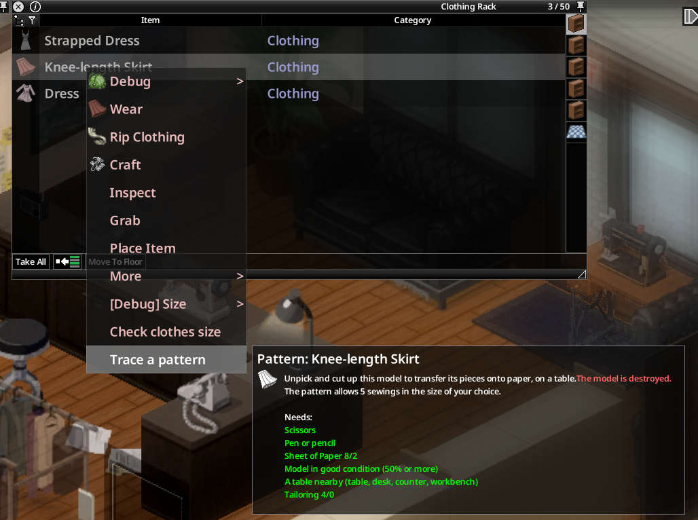
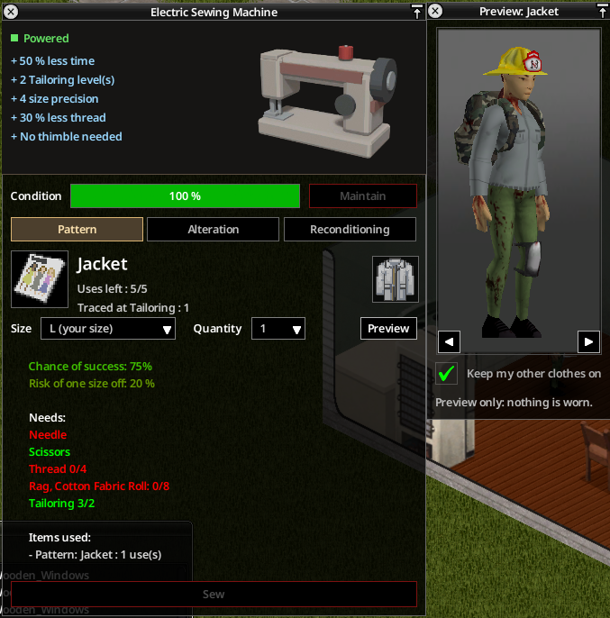

# Sewing patterns

Patterns let you sew a garment or a pair of shoes in **any size**.

## Tracing a pattern

Right-click a sized garment or pair of shoes: **Trace a pattern**.

- Scissors, a pen or pencil, sheets of paper (more for complex clothes).
- A table, desk, counter or workbench nearby (or a treadle sewing machine): your character walks to it.
- The model must be in good condition (**50% or more**) and **is destroyed**: it is unpicked and cut up.
- Tailoring: one level less than needed to sew it.
- The pattern's precision is your Tailoring level when you trace it.

No pattern for ballistic protection, items without a sewable fabric, or rubber and plastic shoes (wellies, flip-flops).

## Store-bought patterns

Printed patterns turn up in sewing shops, tailoring bookshelves and fashion bookstores. Each one is drawn at random among **all** clothes and shoes that could be traced, including those added by other mods, with a good precision (levels 5 to 8).

## Sewing from a pattern

Right-click the pattern: **Sew from pattern**, then pick a size (XS–XXL, or EU 35–47 for shoes). The new item comes out with its size known.

| Fabric of the model | Materials | Fabric difficulty |
|---|---|---|
| Cotton | Ripped sheets, cotton fabric roll | 0 |
| Denim | Denim strips, denim fabric rolls | 1 |
| Leather | Leather strips, tanned leather (small, medium, large) | 2 |

- Needle, scissors and thread (leather work also accepts an awl and a sharp knife), and a thimble by hand.
- Bigger sizes use more fabric.
- Required Tailoring: garment difficulty + fabric difficulty.
- **Precision**: the result can come out one size off. The risk goes from 50% down to 0% with the precision of the pattern plus the Tailoring level of the sewer (zero at 10 levels together). A machine adds precision.
- A pattern survives **5 sewings** (success or failure), then falls apart.

### Shoes

Shoes need **Tailoring 8**, a needle **and an awl**, thread, **glue**, and leather or fabric depending on the model (trainers and slippers in cotton, the rest in leather). They are always sewn by hand.

## Pattern binder

- Craft it with **Make Pattern Binder** (Tailoring: scissors and needle kept, 1 thread, 2 fabric strips of cotton, denim or leather, 2 sheets of paper), or find it on sewing shelves.
- Holds up to **20 patterns**, each with its uses and precision. Weighs 0.3 kg plus 0.1 kg per pattern.
- Right-click a pattern: **Store in binder**. Right-click the binder: **Patterns (n/max)** lists each pattern with **Sew from pattern**, **Take out** and **Preview on me**; **Store all patterns** files every loose pattern you carry.
- Its tooltip lists the stored patterns.
- A sewing machine's Pattern tab also lists the clothing patterns stored in your binders.

> Capture à faire : the binder context menu with its list of patterns.

## Copying a pattern

**Copy pattern**: same needs as tracing (scissors, pen or pencil, paper, a table, the tracing Tailoring level). The original is kept. The copy loses **1 level of precision** (never below 0) and gets fresh uses; a copy of a copy loses it again. Take a pattern out of the binder to copy it.

## Preview on me

**Preview on me** opens a window that shows your character (sex, skin, hair, outfit) wearing the garment or shoes of the pattern, in 3D. Drag with the mouse or use the arrow keys to rotate it; **Keep my other clothes on** toggles the rest of your outfit. Clothes from other mods work too. Nothing is actually worn.

