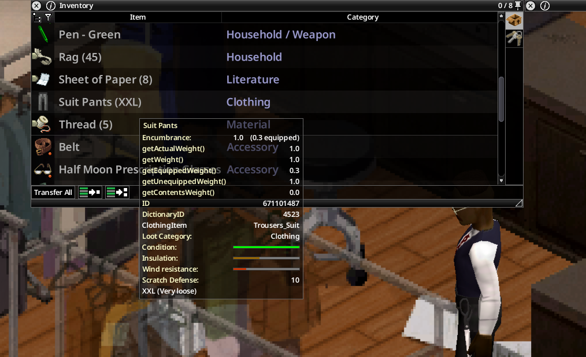

# My Tailor Is Rich

**Clothing & shoe sizes for Project Zomboid Build 42.21 — singleplayer and multiplayer.**

Clothes get a size from XS to XXL, shoes an EU size from 35 to 47. Loot that doesn't fit, read the labels, resize, recondition, trace sewing patterns, sew on electric or treadle machines, dye and embroider your clothes.

## Guides

1. [Installation](01-installation.md) — requirements, enabling the mod, servers.
2. [Getting started](02-getting-started.md) — your size, checking labels, bad-fit effects.
3. [Shoe sizes](03-shoe-sizes.md) — foot size, blisters, lost shoes.
4. [Alterations and wear](04-alterations-and-wear.md) — resizing, wear, reconditioning, crafted clothes.
5. [Sewing patterns](05-sewing-patterns.md) — tracing, store-bought patterns, sewing, binder, copies, 3D preview.
6. [Sewing machines](06-sewing-machines.md) — electric and treadle machines, panel, noise, maintenance.
7. [Dyeing and embroidery](07-dyeing-and-embroidery.md)
8. [Sandbox options](08-sandbox-options.md) — every option for server admins.
9. [Multiplayer](09-multiplayer.md)
10. [FAQ and compatibility](10-faq-and-compatibility.md) — other mods, removing the mod, debug tools.

## Links

- [Steam Workshop page](https://steamcommunity.com/sharedfiles/filedetails/?id=3810122988)
- [Source code (MIT)](https://github.com/cyberbobjr/MyTailorIsRich)
- [Version française du wiki](../fr/Home.md)
