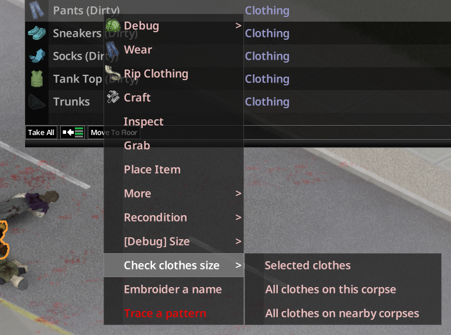

# Premiers pas

## Votre taille

La taille de vêtement de votre personnage suit son **poids** :

| Taille | Poids |
|---|---|
| XS | 50 kg ou moins |
| S | jusqu'à 65 kg |
| M | jusqu'à 75 kg |
| L | moins de 85 kg |
| XL | moins de 100 kg |
| XXL | 100 kg ou plus |

Elle change avec le poids. L'écran Personnage (onglet Info) l'affiche à côté du poids, avec la pointure, par exemple `(L, 43)`. Un mod qui masque le poids (Immersive Weighing) la masque aussi.

> Capture à faire : l'onglet Info du personnage avec la taille et la pointure à côté du poids.

## Quels vêtements ont une taille

Hauts, bas, robes et combinaisons ont une taille, qu'ils viennent du jeu ou d'un autre mod. Les accessoires (chapeaux, masques, gants, bijoux, ceintures, écharpes, chaussettes…), les sous-vêtements et les cosmétiques n'en ont pas. Les chaussures ont leur propre pointure EU : voir [Pointures](03-pointures.md).

## Lire une taille

La taille d'un vêtement trouvé est **inconnue**. Clic droit, puis **Lire l'étiquette** :

- avec assez de Couture (la difficulté du vêtement moins un), le personnage lit l'étiquette et dit la taille exacte ;
- sinon, il devine seulement : « un peu serré », « très ample »… ;
- un vêtement dans un cadavre, un meuble ou un véhicule à portée est lu **sur place**, sans être pris ; au sol, il est d'abord ramassé.

Sur un cadavre, le sous-menu propose **Les vêtements sélectionnés**, **Tous les vêtements de ce cadavre** et **Tous les vêtements des cadavres à proximité** (chaussures comprises). Les lectures groupées sautent les tailles connues et les indices qu'on ne peut pas améliorer avec son niveau actuel.

Une taille connue s'ajoute au nom de l'objet dans l'inventaire et s'affiche dans son infobulle, avec l'ajustement sur vous :

Les vêtements d'un même zombie ont des tailles proches : la même le plus souvent, sinon une de moins ou de plus.

## Vêtement mal ajusté

| Ajustement | Effets |
|---|---|
| Trop grand | Moins d'isolation ; un haut ralentit les attaques ; un pantalon ou une jupe trop grand peut **tomber** sans ceinture quand les deux mains sont prises ; risque de **trébucher** à la réception d'une clôture, même au pas. |
| Trop petit | Plus long à enfiler ; peut **se déchirer** en escaladant ; risque de **trébucher** après un mur ; raideur musculaire des zones couvertes, aggravée par l'exercice. |
| 3 tailles ou plus trop petit | Impossible à enfiler. |

Si le personnage prend du poids, les vêtements devenus impossibles à porter sont retirés. Le personnage dit pourquoi.

## Ensuite

- Ajuster un vêtement : [Retouches et usure](04-retouches-et-usure.md).
- En coudre un à sa taille : [Patrons de couture](05-patrons-de-couture.md).
