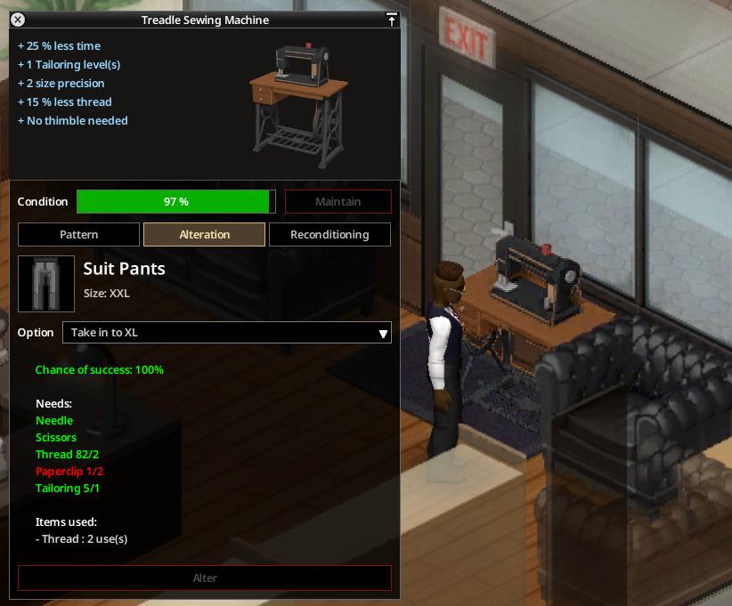

# Retouches et usure

## Retoucher un vêtement

Clic droit sur un vêtement dont la taille est connue : **Retoucher**, puis **Élargir le vêtement** (une taille de plus) ou **Resserrer le vêtement** (une taille de moins). On peut aussi le faire sur une machine à coudre (onglet **Retouche**, voir [Machines à coudre](06-machines-a-coudre.md)).

| | Élargir | Resserrer |
|---|---|---|
| Outils | Aiguille, ciseaux, fil | Aiguille, ciseaux, fil |
| Matériau | Bandes du tissu du vêtement (draps déchirés, bandes de jean, bandes de cuir) | Trombones |
| Couture requise | difficulté + tissu + 1 | difficulté + tissu |

- La difficulté va de 1 (tee-shirt, pantalon) à 3 (robe, combinaison, veste épaisse) ; le tissu ajoute 0 (coton), 1 (jean) ou 2 (cuir).
- Réussite : 50 % au niveau requis, +25 % par niveau au-dessus.
- Un vêtement ne se retouche **qu'une fois**. Environ un vêtement trouvé sur dix a déjà été retouché.
- Une retouche ratée peut user le vêtement.
- À la main, il faut aussi un **dé à coudre** (option sandbox).

## Usure

Les vêtements portés perdent lentement de l'état : saleté, sang, humidité et vêtement trop serré l'accélèrent ; Entretien et Couture la ralentissent. Avec l'état, le vêtement perd ses protections (griffure, morsure, balle) et ses résistances (vent, eau). L'infobulle d'un vêtement porté estime son usure. Les chaussures ne s'usent pas ainsi.

Les rustines vanilla ne changent plus l'état d'un vêtement qui s'use avec ce mod.

## Remettre en état

Clic droit sur un vêtement usé : **Remettre en état**, puis **Avec …** :

- des **bandes de tissu** de son tissu, ou
- **un second exemplaire** du même objet (ni porté ni en main), consommé, qui donne un meilleur résultat.

Il faut aussi aiguille, ciseaux et fil (et un dé à la main). Le résultat dépend de la Couture et de l'Entretien ; chaque réparation rend la suivante moins efficace. Un échec peut user davantage le vêtement.

> Capture à faire : le sous-menu Remettre en état avec les bandes et l'exemplaire de rechange.

## Vêtements fabriqués

Quand une recette produit un vêtement, la fenêtre d'artisanat affiche un **bouton de taille** sur le résultat : chaque clic passe à la taille suivante, de XS à XXL (il commence à votre taille). Le vêtement sort avec cette taille, déjà connue. Si aucune taille n'a été choisie, il sort avec une **taille à choisir** et ne s'enfile pas : clic droit, **Choisir la taille**. Les chaussures fabriquées sont à la pointure de l'artisan.

> Capture à faire : la fenêtre d'artisanat avec le bouton de taille sur un vêtement.
