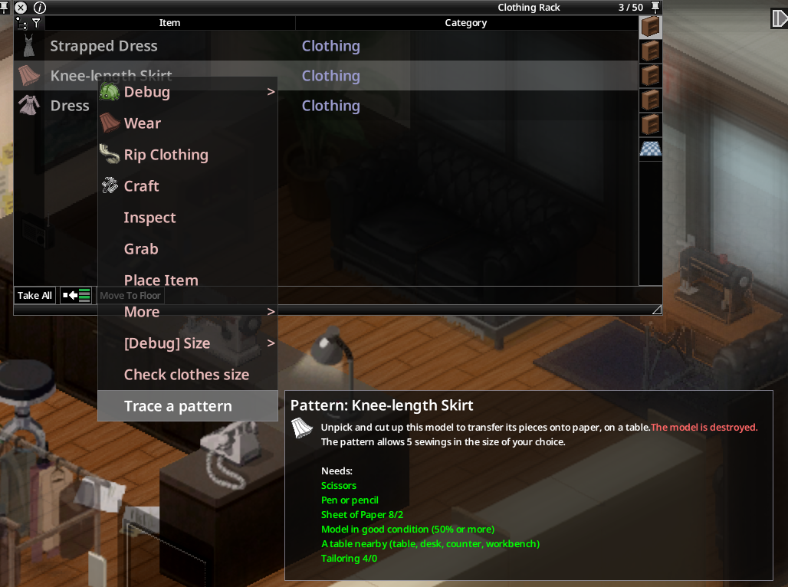
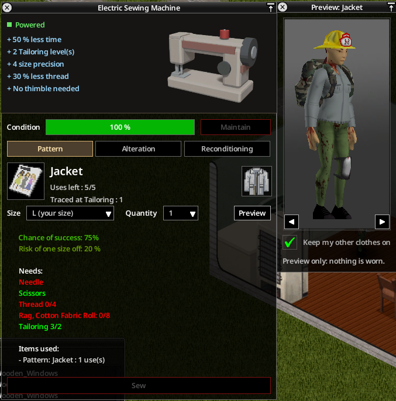

# Patrons de couture

Un patron permet de coudre un vêtement ou une paire de chaussures dans **n'importe quelle taille**.

On peut aussi tracer et coudre des **gants en taille unique**, à la main ou sur une machine à coudre. Le patron conserve le modèle exact et sa matière : coton, jean ou cuir. Les gants d'autres mods sont pris en charge s'ils utilisent un emplacement standard des mains et déclarent un tissu compatible. Une correspondance explicite couvre les mitaines vanilla sans tissu déclaré. Les gants en caoutchouc, chirurgicaux, métalliques ou à matière inconnue sont exclus.

Un patron de gants demande une feuille vierge au tracé, puis deux unités du matériau correspondant et trois utilisations de fil pour une couture à la main (une machine peut réduire le fil). Niveau de Couture requis : 2 pour le coton, 3 pour le jean, 4 pour le cuir, avant bonus de machine (option sandbox : Couture pour les patrons de gants). Aucun risque de taille décalée. Copie, classeurs, aperçu et patrons du commerce prennent aussi les gants en charge. Le tracé détruit les gants d'origine.

## Tracer un patron

Clic droit sur un vêtement ou une paire de chaussures taillés : **Tracer un patron**.

- Ciseaux, stylo ou crayon, feuilles de papier vierges (plus pour un vêtement complexe). Une feuille écrite, renommée ou favorite n'est jamais utilisée.
- Une table, un bureau, un comptoir ou un établi à proximité (ou une machine à pédale) : le personnage s'y rend.
- Le modèle doit être en bon état (**50 % ou plus**) et **est détruit** : il est décousu et découpé.
- Couture : un niveau de moins que pour le coudre.
- La précision du patron est votre niveau de Couture au moment du tracé.

Pas de patron pour les protections balistiques, les objets sans tissu cousable, ni les chaussures en caoutchouc ou en plastique (bottes de pluie, tongs).

## Patrons du commerce

Des patrons imprimés se trouvent dans les merceries, sur les étagères des ateliers de couture et dans les librairies de mode. Chacun est tiré au hasard parmi **tous** les vêtements et chaussures qui pourraient être tracés, y compris ceux d'autres mods, avec une bonne précision (niveaux 5 à 8).

## Coudre d'après un patron

Clic droit sur le patron : **Coudre d'après le patron**, puis une taille (XS–XXL, ou EU 35–47 pour des chaussures). L'objet sort avec sa taille connue.

| Tissu du modèle | Matériaux | Difficulté du tissu |
|---|---|---|
| Coton | Draps déchirés, rouleau de coton | 0 |
| Jean | Bandes de jean, rouleaux de jean | 1 |
| Cuir | Bandes de cuir, cuir tanné (petit, moyen, grand) | 2 |

- Aiguille, ciseaux et fil (le cuir accepte aussi une alêne et un couteau tranchant), et un dé à la main.
- Les grandes tailles demandent plus de tissu.
- Couture requise : niveau du type de vêtement + difficulté du tissu. Chaque type (vêtements simples, moyens, difficiles, gants) a son niveau dans les options sandbox.
- **Précision** : le résultat peut sortir avec une taille d'écart. Le risque va de 50 % à 0 % selon la précision du patron plus le niveau de Couture du couturier (nul à 10 niveaux cumulés). Une machine ajoute de la précision.
- Un patron supporte **5 coutures** (réussies ou ratées), puis tombe en morceaux.

### Chaussures

Les chaussures demandent **Couture 8**, une aiguille **et une alêne**, du fil, de la **colle**, et du cuir ou du tissu selon le modèle (baskets et pantoufles en coton, le reste en cuir). Elles se cousent toujours à la main.

## Classeur à patrons

- Recette **Fabriquer un classeur à patrons** (Couture : ciseaux et aiguille gardés, 1 fil, 2 bandes de coton, de jean ou de cuir, 2 feuilles), ou trouvé dans les rayons de couture.
- Il range autant de patrons que vous voulez, chacun avec ses utilisations et sa précision. Il pèse 0,3 kg plus 0,1 kg par patron.
- Clic droit sur un patron : **Ranger dans le classeur**. Clic droit sur le classeur : **Ouvrir l'album (n)**, ou **Ranger tous les patrons** pour ranger tous les patrons que vous portez.
- L'album s'ouvre comme un classeur de cartes. À gauche, des pages de 3 × 3 pochettes, un patron par pochette (image du vêtement, nom, utilisations restantes) ; on tourne les pages avec les flèches ou la molette. Tapez dans la barre de recherche pour filtrer par nom, catégorie (Haut, Bas, Tenue complète, Gants, Chaussures) ou matériau (Coton, Jean, Cuir) : `haut cuir` trouve les hauts en cuir.
- À droite, votre personnage portant le vêtement choisi, en 3D (rotation, autres vêtements gardés ou retirés), puis sa précision, ses utilisations restantes et les matériaux et outils nécessaires pour votre taille. Boutons : **Coudre à la main**, **Coudre à la machine** (ouvre la machine à coudre la plus proche avec ce patron prêt) et **Sortir**.
- Déposez des patrons de l'inventaire sur la page pour les ranger. Tirez le coin cousu en bas à droite pour agrandir tout l'album ; la taille est retenue.
- Son infobulle liste les patrons rangés.
- Sur une machine à coudre, cliquez sur la case du patron : le même album s'ouvre pour choisir parmi les patrons que vous portez et ceux rangés dans vos classeurs. Le patron reste dans le classeur ; chaque pièce cousue l'use là où il est.

> Capture à faire : l'album de patrons avec un patron sélectionné.

## Copier un patron

**Copier le patron** : mêmes besoins que le tracé (ciseaux, stylo ou crayon, papier, une table, le niveau de Couture du tracé). L'original est gardé. La copie perd **1 niveau de précision** (jamais sous 0) et reçoit des utilisations neuves ; une copie de copie en perd encore. On copie un patron sorti du classeur.

## Déchirer un patron

Un patron dont vous n'avez plus besoin se déchire pour récupérer une feuille de papier : recette **Déchirer un patron** (en main, sans outil).

## Aperçu sur moi

**Aperçu sur moi** ouvre une fenêtre qui montre votre personnage (sexe, peau, cheveux, tenue) portant le vêtement ou les chaussures du patron, en 3D. Faites-le tourner à la souris ou aux flèches ; **Garder mes autres vêtements** montre ou retire le reste de la tenue. Les vêtements d'autres mods fonctionnent aussi. Rien n'est réellement porté.

