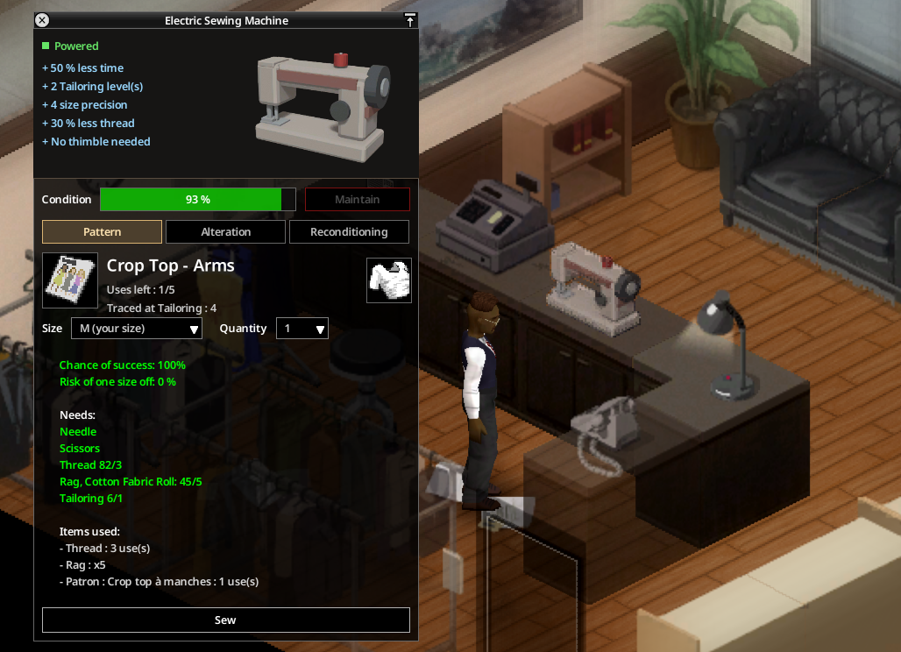

# Machines à coudre

## Deux machines

- **Machine à coudre électrique** : se pose sur n'importe quelle table et demande du **courant** (le réseau à l'intérieur, ou un générateur).
- **Machine à coudre à pédale** : un lourd meuble en fonte posé au sol, sans courant. Elle sert aussi de table pour tracer des patrons.

Où les trouver : ateliers de couture et merceries, magasins de vêtements et grands magasins, rayon linge des supermarchés, rangements (garages, box, greniers, abris, réserves, placards) et, plus rarement, partout où peut se trouver un kit de couture. La machine à pédale se trouve aussi chez les antiquaires. Elles se ramassent et se posent comme tout meuble.

## Le panneau de la machine

Cliquez sur une machine (ou utilisez son option du menu contextuel) pour ouvrir son panneau. Un seul joueur à la fois peut utiliser une machine.

Le haut montre les bonus de la machine (et si elle est alimentée), son **état** et le bouton **Entretenir**. Puis quatre onglets :

- **Patron** : glissez un patron de vêtement dans la case (ou cliquez sur la case pour en choisir un, y compris dans un classeur), choisissez la taille et la **quantité** à coudre d'affilée. Le panneau montre le vêtement obtenu, la chance de réussite, le risque d'une taille d'écart et la liste exacte des objets consommés. Il retient le dernier patron utilisé. Les patrons de chaussures se cousent à la main.
- **Retouche** : élargir ou resserrer un vêtement.
- **Remise en état** : réparer un vêtement usé avec des bandes de tissu ou un exemplaire de rechange.
- **Broderie** : glissez un vêtement, tapez le texte (votre prénom pour commencer, 24 caractères au plus) et vérifiez le nom obtenu. Onglet masqué si la broderie est désactivée.

Le bouton montre la progression (« Couture 2/5... 45 % »). Le personnage marche jusqu'à la machine et travaille face à elle.

## Bonus

| | Électrique | À pédale |
|---|---|---|
| Courant | Requis | Non |
| Vitesse | 50 % de temps en moins | 25 % de temps en moins |
| Niveaux de Couture | +2 | +1 |
| Précision de taille | +4 | +2 |
| Fil | 30 % de moins | 15 % de moins |
| Dé à coudre | Inutile | Inutile |
| Broderie | Couture 1 (bonus compris), deux fois plus rapide qu'à la main | Couture 3 (bonus non compté : point droit seulement), 25 % plus rapide |

L'option sandbox **bonus des machines** règle tous les bonus.

## Bruit

Une machine en marche s'entend des zombies, l'électrique bien plus loin que la pédale. Les joueurs proches l'entendent aussi.

## Entretien

- Les machines s'usent à l'usage. Sous **50 %**, elles sont moins fiables et cassent parfois l'**aiguille** tenue ; à **0 %**, elles se **bloquent**.
- **Entretenir** avec un tournevis et un peu d'huile de cuisine (végétale ou d'olive). La compétence de réparation est l'**Électricité** pour la machine électrique, la **Mécanique** pour la machine à pédale ; plus elle est haute, plus l'état remonte.
- La machine garde son usure quand on la ramasse et la repose.

> Capture à faire : une machine bloquée à 0 % et les besoins de l'entretien.
